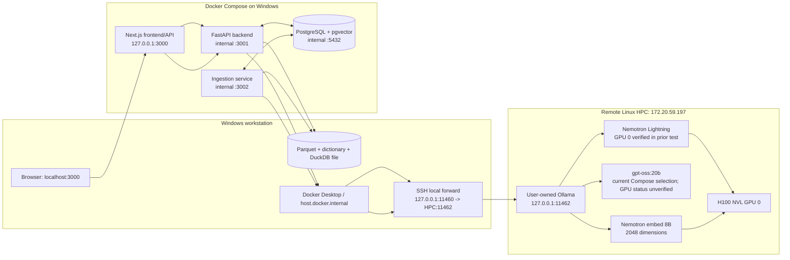

# Auto-Ontology Development Log

**Date:** 2026-11-18  
**Coverage:** Work reconstructed from the recent project conversation and local artifacts, approximately 2026-11-11 through 2026-11-18. This is a technical activity log, not a timecard.  
**Repository:** `NVIDIA/auto-ontology`, local Windows workspace  
**Status:** Local CAB760 component ontology is populated and structurally verified. Natural-language answer quality and engineering conclusions remain unverified.

## Executive Summary

During the past week, Auto-Ontology was brought up locally, connected to an Ollama service on the HPC host, extended for OpenAI-compatible Ollama model names and configurable embedding dimensions, and used to model a CAB760 Parquet export as a design-point fact view plus four component views. Source-generation code and full-file data checks were used to validate source-scoped keys, loss identities, and relationships. Four semantic relationships were applied through a staged and read-back-verified native model import. The HPC Ollama installation was later moved to a user-owned binary and a different port; a direct test then confirmed the Lightning model running 100% on GPU 0. Most recently, the local Compose override was changed to use `gpt-oss:20b` for reasoning and non-reasoning requests.

The structural model is in place, but it is not an engineering certification. A successful direct Ollama prompt and working model imports do not prove that Auto-Ontology's chat can produce correct SQL, rows, or prose. Those chat-answer checks remain to be done.

## Timeline and Work Completed

### Local deployment and privacy boundary

- Source-image builds encountered a corporate certificate-inspection/TLS trust failure. The local stack was run using public Auto-Ontology release images instead of disabling TLS verification.
- A Compose override was used for the release image, local DuckDB source, local runtime-file mounts, and HPC model endpoints.
- The frontend is bound to `127.0.0.1:3000`. Backend, ingestion, and Postgres have no host-published ports in the local override. A Docker `internal: true` network interfered with Windows localhost forwarding, so the stack uses a normal Docker bridge instead. Loopback-only UI binding is not a blanket outbound-network firewall.
- The Parquet, dictionary, and DuckDB source are mounted read-only in the application containers. PostgreSQL with pgvector stores the catalog, semantic layer, and embeddings; DuckDB is an embedded source, not a separate database-server container.
- NVIDIA-hosted inference is not configured. The OpenAI-compatible provider setting selects the client protocol used to talk to Ollama; it does not mean requests go to OpenAI.

### Runtime integration changes

The Auto-Ontology runtime was adapted for this local inference setup:

- `auto_ontology/utils/llm_invoke.py` accepts explicit `auto`, `openai`, or `nvidia` provider selection and supports reasoning/non-reasoning provider environment variables. Existing automatic routing remains the default.
- `auto_ontology/utils/embedding.py` reads `EMBED_DIMENSIONS` through embedding parameters and sends the requested dimensions when supported. The configured local vector dimension is 2048.
- `auto_ontology/connectors/duckdb.py` reads DuckDB column comments as column descriptions, allowing the supplied dictionary to contribute column metadata.
- README documentation and focused tests were added for provider selection, embedding dimensions, and DuckDB metadata. The earlier focused validation run reported 78 tests passing plus clean Ruff check/format. Four local synthetic tests for the CAB760 views also passed.

### CAB760 data and source semantics

- Source data: `CAB760M12HM3_GRIDDED_REMOVAL_PD1_together.parquet`, 5,758,662 rows and 216 columns, with a dictionary CSV covering the columns. The file was checked against a matching copy in PEOptima. The user clarified that `busbar_gap_distance_mm` means “vertical distance between busbar planes.”
- Private `python_vpp` source was inspected to ground the generated identifiers. `PD_ID`, `group_ID`, `EMI_ID`, and `CB_ID` are ordinal/local identifiers, not global business keys. `point_id` is unique in this export but is not proven stable across regeneration. `Original_CB_Row` is a local filtered-table row index, not a durable source row ID.
- The verified relationship keys are scoped to this source export. The EMI/filter candidate requires `(PD_ID, group_ID, EMI_ID)`; `EMI_ID` alone and `(group_ID, EMI_ID)` produce conflicts. The full-file negative test found all 199 raw `EMI_ID` values reused across distinct scoped candidate keys.
- The checked-in `run_looper_comp1.py` lists CAB400 inputs, although shared pipeline code supports CAB760. The exact invocation/configuration that produced this CAB760 export was not independently recovered, so source-code lineage is informative but not full run provenance.

### Component views and safe joins

A DuckDB preparation helper builds a base design-point view and four read-only projections:

| View | Rows | Identity key |
|---|---:|---|
| `cab760_design_points` | 5,758,662 | export-scoped `design_point_key` |
| `cab760_module_scenarios` | 136,554 | export-scoped `module_scenario_key` |
| `cab760_module_types` | 1 | export-scoped `module_type_key` |
| `cab760_cap_busbar_candidates` | 1,668 | export-scoped `cap_busbar_key` |
| `cab760_emi_filter_candidates` | 411,440 | export-scoped composite `emi_filter_key` |

- The export hash is folded into each generated key. A standalone `source_export_id` metadata column was removed because semantic FK inference treated it as a possible relationship. The corrected file is `.cache/cab760-graph-v2.duckdb`, mounted read-only at the existing logical database path so the Postgres catalog identity remains `cab760-graph`.
- Catalog re-ingestion deleted the five obsolete `source_export_id` columns. The corrected DuckDB file exposes zero columns by that name and exactly the five intended views.
- Each of the four component-key inner joins was executed over the full dataset and preserved all 5,758,662 design-point rows. Synthetic tests validate unique dimension keys, non-fanout behavior, dictionary comments, and the absence of a standalone export hash.

### Loss and association evidence

All stated comparisons below use all 5,758,662 rows and are data/source evidence, not independent engineering approval.

- Exact observed module identity: `total_loss = conduction_loss + turn_on_switching_loss + turn_off_switching_loss + reverse_recovery_loss`; maximum absolute residual was 0.
- Approximate observed converter identity: `total_losses ~= total_loss + cap_power_loss_W + Losses_filter_W`; all rows were within `max(0.001, abs(total) * 0.0001)`. Mean absolute residual was about `0.0000539`; maximum about `0.0004791` in stored numeric units.
- Substituting `cap_power_loss_W_1_13M` for `cap_power_loss_W` matched zero rows within tolerance. The approximate formula follows implementation in the upstream sweep and `python_vpp`; it is not independent engineering validation. Do not assign a per-row loss as an invariant component property or sum repeated simulation points as simultaneous operation.
- Descriptive Pearson examples: capacitor capacitance vs total cost `+0.879`; switching frequency vs efficiency `-0.604`; coolant temperature vs efficiency `+0.442`. These are associations, not causal influence. `power_factor` has one distinct value, so its correlation is undefined.

### Semantic compilation and model publication

- `cab760-graph` was ingested as five tables. Compilation generated terms and initially exposed a candidate `source_export_id` edge. The run was cooperatively stopped; the stop did not immediately interrupt its in-flight model request. The corrected view file was built separately and switched in after a user-approved targeted restart of backend and ingestion services. Postgres volumes were preserved; no semantic reset was performed.
- After re-ingestion, the supported semantic compilation run completed successfully but produced zero new terms and zero FK edges because the existing columns already had attributes. This showed that simply recompiling would not add the desired links.
- The existing model was exported before changes. A separate staging Compose project with its own Postgres volume validated the original import and additive proposal. Its initially imported IDs were remapped; a strict identity-map comparison covered 697 entities and proved full staging readback parity.
- Four links were then applied to the live catalog using the supported native model import with `replace=false`: the design-point scenario, module type, capacitor/busbar, and EMI/filter keys each link to the matching component-key attribute. The import created no replacement entities and changed only those four relationships.
- Four generated glossary labels/descriptions were corrected through term PATCHes: `CAB760 Design Point`, `EMI Filter Candidate`, `EMI Filter Choke Mass`, and a source-grounded `Module Scenario` description. Certification flags were not set.
- The final scoped live model export was compared field-for-field with the staged reviewed proposal, including original IDs, properties, and relationships. The graph DAL independently reported exactly the four expected directed joins. The public semantic graph endpoint showed the resulting term connections.
- The final export is `.cache/cab760-graph-ontology.yaml`. Backups `.cache/cab760-graph-pre-resume.yaml` and `.cache/cab760-graph-pre-apply.yaml` remain. Staging containers/network were removed after checks; its separate Docker volume was retained.

### HPC Ollama and chat connectivity

The inference configuration changed during the week, so distinguish the verified states:

1. Initially the app targeted `nemotron-3.5-lightning:latest` at Windows/Docker `host.docker.internal:11460`, using a local SSH forward. The earlier Ollama instance reported context 4096 and 97% CPU / 3% GPU, making large prompts slow. A direct native API draft later succeeded with request-local context 32768; no persistent model setting was changed then.
2. On 2026-11-17 the user identified a user-owned Ollama installation at `/home/mladm/ollama-linux/bin/ollama`, version 0.40.16, on HPC host `172.20.59.197` (`simtcuat1902.tcc.etn.com`). It listens on `127.0.0.1:11462`, stores models under `/mldata/ollama/.ollama/models`, and selects H100 GPU 0 by UUID. The SSH tunnel maps Windows `127.0.0.1:11460` to HPC `127.0.0.1:11462`; Auto-Ontology Compose continues to use local port 11460.
3. A direct HPC `/api/chat` test returned `OK`. `ollama ps` reported `100% GPU`, context 8192; `nvidia-smi` showed the Ollama runner using about 25.2 GiB on GPU 0. This verifies direct Ollama inference placement for that test. GPU 1 is intentionally not selected.
4. Local Windows `/api/tags` and Docker-to-Ollama `/api/tags` checks returned successfully after the tunnel was corrected. An earlier Auto-Ontology chat attempt logged a connection failure (`Network is unreachable`) during SQL generation; a subsequent request reached the `question_intent` stage. A complete, validated Auto-Ontology answer was not confirmed in that exchange.
5. The latest inspected `.cache/compose.release.yaml` (updated after the initial Lightning setup) selects `gpt-oss:20b` for both reasoning and non-reasoning requests; both still use the OpenAI-compatible Ollama endpoint at `http://host.docker.internal:11460/v1`. Embeddings still use `maternion/nemotron-3.5-embed:8b` at 2048 dimensions. The direct 100%-GPU verification above was for Lightning, not a new verification of `gpt-oss:20b`.

The `ssh -N` tunnel command is expected to leave its terminal open without a shell prompt. Keep it running; use a different terminal for Docker or browser work. A password prompt followed by a quiet terminal is normal after successful authentication. Do not change or stop the separate system-owned Ollama service when managing the user-owned instance.

### Architecture visualization request

A prompt was prepared for the user to give another LLM to render a three-boundary Windows/Docker/HPC architecture diagram. It describes browser-to-frontend flow, internal backend and ingestion services, PostgreSQL/pgvector, local DuckDB/Parquet, SSH-tunneled Ollama chat and embeddings, security boundaries, and explicit non-assumptions.

## Current Architecture

The diagram records the intended/observed data paths; it is not a network security audit. Only the frontend is host-published by the Compose override. Inference prompts can include schema, selected samples, and retrieved context sent to HPC, even though the full source file remains local.

## Artifacts and Verification Evidence

| Artifact | Purpose / status |
|---|---|
| `.cache/compose.release.yaml` | Local release-image override; latest inspected reasoning model is `gpt-oss:20b`. |
| `.cache/cab760-graph-v2.duckdb` | Corrected, read-only five-view source database. |
| `.cache/prepare_cab760.py` | Builds the export-scoped component views and dictionary comments. |
| `.cache/test_cab760_views.py` | Four synthetic regressions; last recorded run passed. |
| `.cache/cab760-profile.json` | Full-file identity, loss, and correlation profile. |
| `.cache/cab760-reviewed-concepts.yaml` | Reviewed conceptual sketch, not an import file. |
| `.cache/cab760-reviewed-validation.json` | Key and join validation receipts. |
| `.cache/cab760-ontology-review.md` | Evidence review; its opening checkpoint is current, but later sections include earlier draft-stage statements and should be read historically. |
| `.cache/cab760-graph-ontology.yaml` | Final scoped native model export after links and metadata updates. |
| `.cache/cab760-graph-pre-resume.yaml`, `.cache/cab760-graph-pre-apply.yaml` | Scoped before-state exports. |
| `.cache/link_cab760_model.py` | Validation/identity-map helper for staged proposal comparison. |
| `.cache/compose.staging.yaml` | Temporary isolated staging override; containers/network removed after verification. |

## Outstanding Work and Caveats

- Test an Auto-Ontology membership question end to end; inspect generated SQL, returned rows, and join cardinality.
- Validate loss-question SQL and results against the full-file formulas and units. Do not substitute worst-case capacitor loss without evidence.
- Test an association question and describe correlations as descriptive only. No causal/engineering-influence claim is supported yet.
- Verify how the currently selected `gpt-oss:20b` is placed on GPU with `ollama ps` and `nvidia-smi`; the earlier 100%-GPU evidence applies to Nemotron Lightning.
- Confirm the SSH tunnel remains available at local port 11460 whenever chat is used.
- The exact CAB760 generation-run configuration and stable cross-export identity are still unconfirmed. Carry source/run identity when combining exports.
- The model is reviewed structure, not an engineering-certified ontology or an atomic promotion. Semantic graph display edges do not by themselves prove physical assembly relationships.
- Credentials in a previously shared `.env` attachment should be rotated. No secret values are reproduced here.

## Operational Notes

- Open the UI at `http://localhost:3000`; use **Exploration** to inspect terms and links, and **Chat** for the pending end-to-end query validation.
- The Windows tunnel is local port `11460`; its current known remote destination is HPC `127.0.0.1:11462`.
- The current model choice should be confirmed from the file and running containers before assuming a model change has taken effect; Compose edits alone do not prove containers were recreated with the new environment.
